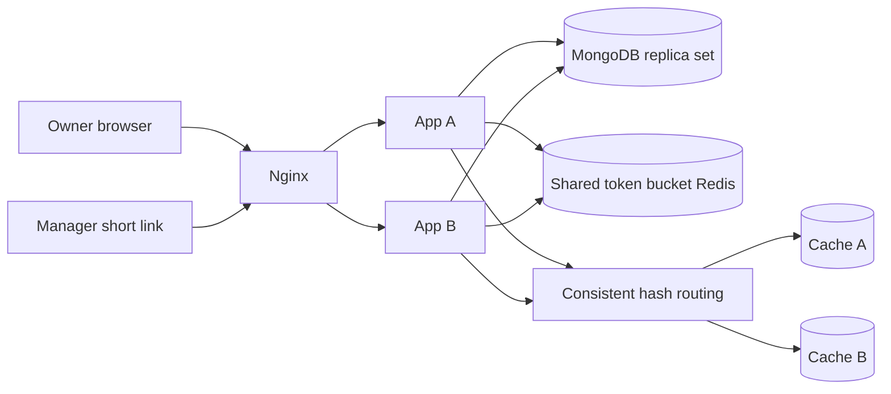
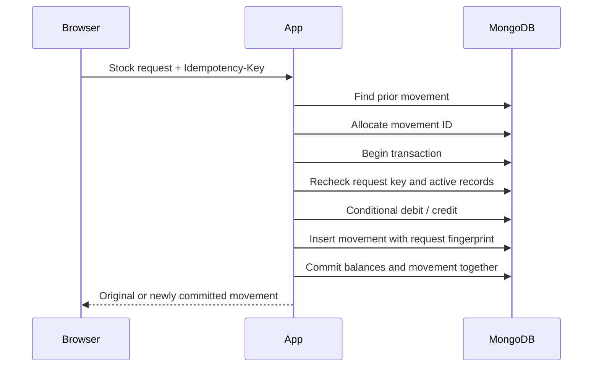

# System design

## Application and data

Controllers parse requests. Services apply inventory and access rules. `InventoryRepository` owns collection access, index setup, transactions, and ID allocation. Spring Boot configures the MongoDB client and connection pool. The repository uses the synchronous MongoDB driver supplied by Spring Data.

Collections are `products`, `suppliers`, `warehouses`, `balances`, `movements`, `links`, and `counters`. References use string IDs. Stock uses signed 64-bit whole numbers. Input quantities are limited to one billion units per operation; balances are limited to one trillion. Decimal quantities are rejected. Dates are stored as BSON dates and returned as UTC strings.

The counter increments atomically for every allocation, across both apps. Allocated IDs increase, but completion order can differ, and failed operations leave gaps. A strict shared sequence is a write bottleneck at very high scale. Use range allocation or a time-based ID service if strict allocation order can be relaxed.

Balances have a unique `(warehouseId, productId)` index. SKU, warehouse code, movement request key, and link-code hash are also unique. Autocomplete has compound indexes on active status and normalized name/SKU. Movement indexes support source and destination warehouse history.

## Stock transactions

A debit condition requires sufficient stock. Transfers debit and credit in the same transaction. The native driver's `withTransaction` callback retries transient transaction failures and uncertain commits within a ten-second transaction timeout. See the [MongoDB Java transaction API](https://mongodb.github.io/mongo-java-driver/5.8/apidocs/driver-sync/com/mongodb/client/ClientSession.html).

Transaction callbacks do not send responses, populate caches, or perform other external side effects. ID allocation happens before the callback. The original key and payload are retained for browser retries. Conflicting key reuse returns 409. A database timeout returns 503 and asks the caller to reuse the same key.

Stock transactions update a revision on referenced active products and warehouses. Archive and metadata writes therefore conflict with concurrent stock writes and retry against current state. This protects archive rules. It also serializes writes to a hot product, which is a deliberate correctness-first tradeoff for this project.

## Token bucket

Each client IP has one shared bucket. It starts with 60 tokens and refills at two tokens per second, up to capacity. Each API or short-link request consumes one token. Static assets and health checks do not consume tokens.

One Lua script uses Redis time, refills the bucket, checks it, consumes a token, writes state, and assigns expiry atomically. Idle keys expire after the full-refill time plus one second. On denial, the response includes a rounded-up `Retry-After`. Rate-limit Redis failure returns 503. App-local buckets are not used. See the [Redis algorithm guide](https://redis.io/tutorials/howtos/ratelimiting.md).

Both apps trust only the configured Nginx peer for `X-Real-IP`. Nginx replaces forwarded client headers. Direct callers cannot choose a bucket by supplying a header. Users behind the same NAT share an IP bucket; a future authenticated system could use account IDs instead.

## Consistent hashing and key-value caching

SHA-256 places 128 virtual nodes per configured cache endpoint on a sorted ring. A key uses the next clockwise node, wrapping at the end. Input node order does not change routing. Adding a node moves only keys that now map to that node; removing one moves only its keys.

Only autocomplete results are cached. Keys contain a hash of the normalized prefix. Values are JSON records with a 15-second TTL. A cache miss or failed cache request falls back to MongoDB. Catalog edits can take up to 15 seconds to appear in suggestions; stock actions revalidate all referenced records in MongoDB. Balances, movement decisions, and link authorization are never cached.

Cache endpoints and node membership are configuration, not automatic discovery. When changing the cache topology, deploy the same membership to both apps. Old keys expire naturally. Cache counters are per app instance.

The small `RedisClient` is a bounded RESP2 adapter built with JDK sockets. It supports the commands required by this assignment and opens a connection per command. It applies connection/read timeouts and response-size limits. It has no external dependency to download. It is not a general-purpose Redis client: TLS, Redis authentication, clustering, connection pooling, and discovery are not included. The Docker network is its intended boundary. Use a maintained pooled client for a production rollout.

## Warehouse access and shortened links

Owner APIs require the configured secret in an authorization header. Its hash is compared in constant time. There are no owner accounts or server sessions. The browser keeps the key only in memory.

A short-link code is 16 cryptographically random bytes encoded as 22 URL-safe characters. MongoDB stores only its SHA-256 hash and warehouse mapping. The short route validates the mapping, then redirects to `/shared.html#code`. The manager page sends the code in its authorization header. API calls never accept a warehouse selector for shared views.

The manager APIs check the link and warehouse status for every request. Revocation is shared across instances without a cache. Transfer records hide the other warehouse’s identity. Shared responses use `Cache-Control: no-store`; referrers are disabled; browser scripts and styles come only from the application. Proxy and app access logs are disabled. An owner can copy a new code once; listing links returns metadata only.

## Scale boundaries

Two app instances demonstrate stateless horizontal scaling and shared consistency. Nginx uses passive failure detection and can retry safe reads on the surviving app. Non-idempotent upstream retries are not enabled. Clients retry writes with their original idempotency key.

This is a local teaching deployment. MongoDB has one replica-set member; rate Redis and Nginx are single services. It is not an end-to-end high-availability cluster. The unauthenticated databases are isolated inside the local Docker network. Do not attach untrusted containers to that network.

For a larger deployment, use a multi-member MongoDB replica set, replicated Redis with monitored failover, a redundant load balancer, secret management, TLS, measured connection pools, backups, and per-workload indexes. Profile hot-product contention and the global ID counter before sharding. Offset pagination is bounded but still becomes expensive at deep pages; switch to cursor pagination when measurements justify it. Do not claim support for millions of users without representative capacity tests.
